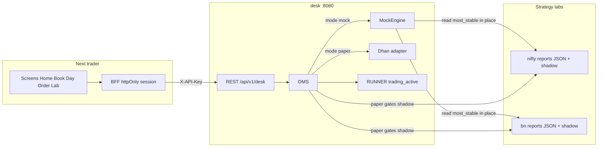
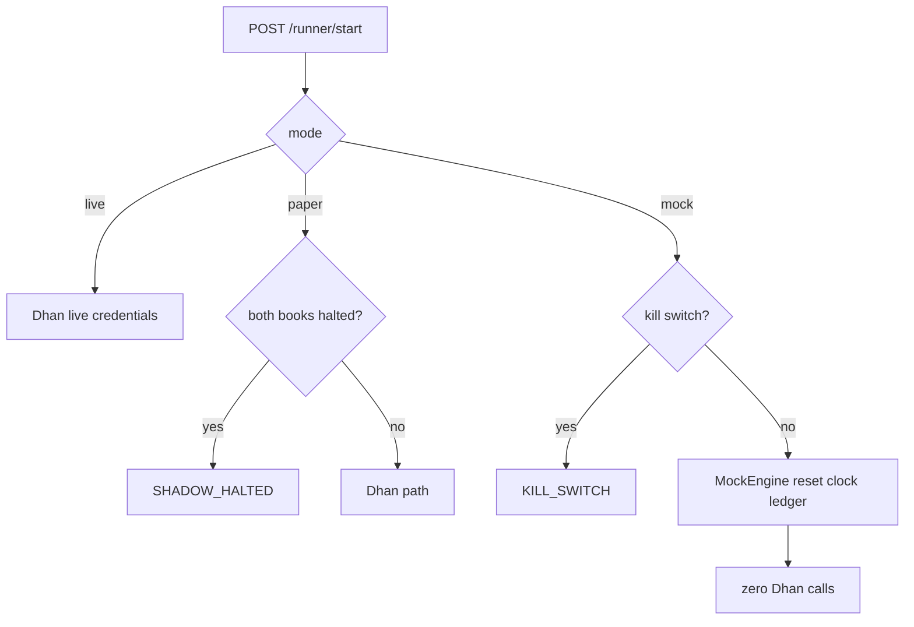
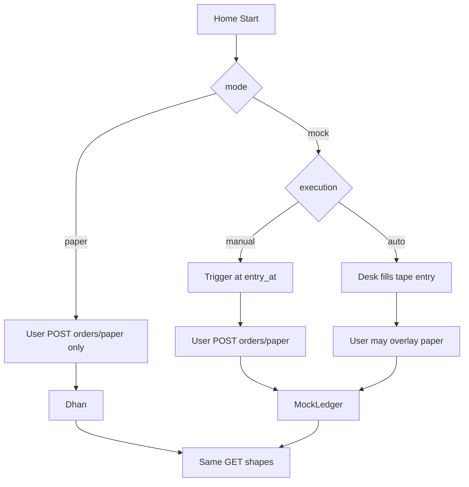
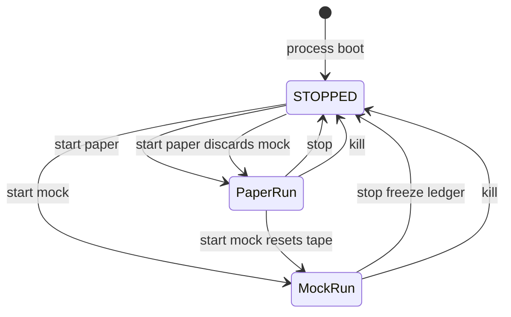

# Backend business logic — Options Edge Desk

**Audience:** Client principal architects and UI/OMS implementers  
**Process:** `Options-Edge-Desk` on `http://127.0.0.1:8080`  
**JSON base:** `/api/v1/desk`  
**Companion contracts:** [`BACKEND_REQUIREMENTS.md`](./BACKEND_REQUIREMENTS.md) (field freeze), [`UI_API_CONTRACT.md`](./UI_API_CONTRACT.md) (caller cheat-sheet)

This document is the **execution and accounting specification**. If a field name conflicts with older notes, `BACKEND_REQUIREMENTS.md` wins. Optional keys may be added; renaming a required key is a breaking change.

---

## Document map

| § | Topic |
|---|--------|
| 0 | Product lock (non-negotiable) |
| 1 | Multi-repo topology and tape ingest |
| 2 | Mock engine (clock, marks, broker bypass) |
| 3 | Execution pipelines (paper / mock-manual / mock-auto) |
| 4 | OMS, validations, two-book ledger, PnL |
| 5 | Sync and lifecycle (Start/Stop/boot/mode switch) |
| 6 | Edge cases and failsafes |
| 7 | Transport, inventory, polling, WebSocket |
| 8 | Paper (Dhan) path — what mock does not replace |
| 9 | Lab research (locked packs) |
| 10 | End-to-end scenario matrix |
| 11 | Explicitly out of the trader app |
| 12 | Known limits (honest QA bounds) |

**Mode × Auto/Manual (six cells, every trader API, fill-notice vs approval):** [`MODE_SCENARIO_MATRIX.md`](./MODE_SCENARIO_MATRIX.md). Use that file for client gap review.

---

## 0. Product lock

| Rule | Binding behavior |
|------|------------------|
| One desk | NIFTY and BANKNIFTY only. No equity desk, no `:8081`, no `:8090` job runner, no second process. |
| Modes | Trader Start sends `paper`, `mock`, or `live`. `execution` is `manual` or `auto` on all three. |
| Start/Stop | Arms **trading only**. uvicorn and Dhan token renew stay up. Start does not boot the VPS. Stop does not kill it. Process always boots `STOPPED`. |
| Who places | **Manual:** only `POST /orders/paper` `dry_run: false`. **Auto:** desk sends strategy fills (mock tape / paper+live PENDING). Overlay still `/orders/paper`. |
| Two books | Separate capital, gates, halt, realized, open MTM. Home `books[]` length 2. |
| Qty | Always `lots × lot_size`. If `lots` is present, `quantity` is ignored. |
| Secrets | `DESK_API_KEY`, Dhan PIN, TOTP never go to the browser. Next BFF injects `X-API-Key`. Desk has no email/password/PIN/TOTP trader routes. |
| Token UI | Show `token_ok` only. No token form. |
| Kill | UI **reads** `kill_switch_active` on `/status`. No Safety page. Do not call `POST /safety/kill-switch` from the app (ops leftover only). |
| Cancel | `POST /orders/cancel` is allowed while trading is stopped. Kill may still return `KILL_SWITCH`. |
| Time | JSON timestamps UTC `Z`. UI formats IST. `day` = NSE cash session calendar date in IST. |
| Session | Cash 09:15–15:30 IST. Weekends `closed`. After close: review allowed; new place refused (`MARKET_CLOSED`). Mock uses **sim** session, not wall clock. |
| Screens | Auth → Home → Book → Day → Order → Lab. No extra trader tabs. |
| Envelope | `ok: true` means the desk answered, **not** that the order was accepted. Business rejects: HTTP **200** + `data.accepted: false` + `data.code`. Never 409/422 for gate/broker/halt. |

---

## 1. Multi-repo topology and connection

Three git/work trees. One execution process.

| Repo | Env / default path | Owns | Desk relationship |
|------|--------------------|------|-------------------|
| **desk** | this repo | FastAPI, OMS, runner, mock engine, Dhan adapter, envelopes | Does **not** duplicate strategy JSON. Reads labs by path. |
| **nifty** | `NIFTY_LAB_ROOT` → `D:/Options-Nifty-Edge-Lab` or `/root/Options-Nifty-Edge-Lab` | NIFTY configs, shadow journals, locked tapes | Paper: gates + shadow. Mock: `most_stable` tape read-only. |
| **banknifty** | `BN_LAB_ROOT` → `D:/Options-Edge-Lab` or `/root/Options-Edge-Lab` | BANKNIFTY configs, shadow, locked tapes | Same split. |
| **trader** (Next) | not this repo | Invite login, fingerprint, BFF proxy | Never holds `DESK_API_KEY` in `NEXT_PUBLIC_*`. |



### Tape ingest (mock) — no copy

Catalog: [`app/research/stable.py`](../app/research/stable.py) `PACKS`. Mock loads **only** `selection == "most_stable"`:

| Book | pack_id | File under lab root |
|------|---------|---------------------|
| NIFTY | `nifty_tier1_conservative` | `reports/nifty_trades_tier1_conservative_2l.json` |
| BANKNIFTY | `bn_paper_25pct_2l` | `reports/clean_25pct_gap300_scale.json` (`run_id: clean_25pct_2l`) |

[`app/mock/tape_index.py`](../app/mock/tape_index.py) opens those paths **in the lab trees**. Nothing is copied into `desk/data`.

Indexed fields: `day`, `sleeve`, CE/PE, `strike`, `symbol`, `lots`, `entry`, `exit`, `exit_reason`, `gap_pts`, `net_pnl`.

**Replay day:** pick per-book source day preferring both TP and stop; remap both books onto one sim calendar `replay.day`. Current canned pick: **`2026-06-25`**.

**Synthetic schedule** (tapes have no intra-day clock):

| Event | Rule |
|-------|------|
| Entry / signal | `09:30 IST + i × 8 minutes`, cap `14:30` |
| Skip window (manual) | `entry_at + 8 minutes` |
| Exit | TP ≈ 35% of remaining session; stop ≈ 65%; cap ~15:20 IST |

Lab chips do **not** choose the mock tape. Mock always uses `most_stable`.

---

## 2. Mock engine core (clock, interpolation, broker bypass)

### Isolation

| Mode | Dhan | Ledger | Clock |
|------|------|--------|-------|
| `paper` | Yes (quotes, positions, place, cancel, cash) | Broker + lab shadow journals | Wall IST |
| `mock` | **Never** for quotes/place/positions/sync/PnL | In-memory `MockLedger` | Sim IST |
| `live` | Not armed from this app | — | — |

Token auto-renew may still run in the process. It is **ops**, not mock accounting.



### Start / Stop

**`POST /runner/start`**

```json
{ "mode": "mock", "execution": "manual", "operator_id": "ui", "speed": 60 }
```

| Field | Default | Rule |
|-------|---------|------|
| `mode` | `paper` | `paper` \| `mock` \| `live` |
| `execution` | `manual` | `manual` \| `auto` (all modes) |
| `speed` | `60` | Mock only; minimum 1. 60x ≈ 6.25 minutes wall for a full session |
| `operator_id` | `ops` | UI sends `ui` |

| Start outcome | `accepted` | `code` |
|---------------|------------|--------|
| Armed | true | `OK` |
| Already paper-armed, Start paper again | true | `OK` (idempotent; message “server was already running”) |
| Mock Start again | true | `OK` — **resets** replay day and ledger |
| Kill on | false | `KILL_SWITCH` |
| Paper + both books DD halted | false | `SHADOW_HALTED` |
| `mode: live` | true | `OK` — Dhan live |

**`POST /runner/stop`**

```json
{ "operator_id": "ui", "reason": "stop" }
```

| Effect | Paper | Mock |
|--------|-------|------|
| `trading_active` | false | false |
| Process | stays up | stays up |
| Positions / Day | stay (broker) | ledger **frozen**, still readable |
| Sim clock | n/a | paused (`playing: false`) |
| New place | `TRADING_STOPPED` | `TRADING_STOPPED` |
| Cancel | allowed | allowed |

### Sim clock

| Parameter | Value |
|-----------|--------|
| Default `replay.day` | `2026-06-25` |
| Window | 09:15–15:30 IST on that date |
| Speed | default 60x |
| `market_session` | from sim time (`pre` / `open` / `closed`) |
| Close | time **clamped** at 15:30; `replay.playing: false` |

### Synthetic marks

Not a market replay. Linear premium path:

`LTP(t) = entry + (exit − entry) × clamp((t − t_entry) / (t_exit − t_entry), 0, 1)`

| t | LTP |
|---|-----|
| ≤ entry | `entry` |
| between | linear |
| ≥ exit | `exit` |

**Bid = Ask = LTP.** `quoted_at` is sim time as UTC `Z`.

**Index spots:** dummy path around first tape strike ± `gap_pts` so Home tape is never null. `change_pct` is signed percent points.

---

## 3. Execution pipelines

**Six-cell matrix (mock/paper/live × manual/auto), interrupt roles, and per-route behavior:** [`MODE_SCENARIO_MATRIX.md`](./MODE_SCENARIO_MATRIX.md).

Three pipelines **ship today**. Same REST inventory.



### Paper (production MVP)

| Rule | Behavior |
|------|----------|
| Triggers | PENDING engine cards from **today’s** shadow journals (IST `day`). Newest unacked → `/triggers/active`. |
| Place | UI only. Engine **must not** call `/orders/paper`. |
| Ignore | Card stays PENDING until journal/fill updates it; not auto-expired by desk skip window (that window is mock-only). |
| Broker | Dhan paper product flags stay server-side. |

### Mock manual

| Sim time | Engine | UI |
|----------|--------|-----|
| Before `entry_at` | Compass row `PENDING`; **not** on `/triggers/active` | No alert |
| At `entry_at` | Newest PENDING unacked is the interrupt | Center alert; confirm opens ticket |
| Place | `/orders/paper` `dry_run: false` | **Order sent** / reject cards |
| Ignore until `skip_at` | `SKIPPED` / `ignored` | Alert gone; no position |
| Still PENDING at `exit_at` | `SKIPPED` | No fill |
| After fill, at `exit_at` | Auto-close remaining tape qty — **no sell trigger** | Day `take_profit` / `stop` |

### Mock auto

| Rule | Behavior |
|------|----------|
| `/triggers/active` | Always `{ active: false, trigger: null }` |
| Entry | Desk open-buy tape lots at synthetic LTP; compass `EXECUTED` / `auto` |
| Overlay | User BUY/SELL via `/orders/paper` still allowed (scale-in / early exit). Overlay lots are **not** tape lots. |
| Exit | Tape `exit_at` sells **only `tape_qty`**. Overlay stays open until user SELL or 15:30 `session_close`. |

`kind` on a trigger is `buy` or `sell` from signal `action`. Mock tape entries are **buy** interrupts only. Sell is ticket overlay or tape auto-close of `tape_qty`.

---

## 4. OMS and ledger accounting

### Mutation envelope (Start, Stop, Place, Cancel, Sync, Ack)

HTTP 200:

```json
{ "ok": true, "server_time": "…Z", "data": { "accepted": true, "code": "OK", "message": null } }
```

`accepted: false` ⇒ nothing armed / placed / cancelled / synced.

### `GET /status` (Home)

Always: `desk_process`, `trading_active`, `runner_state`, `mode`, `token_ok`, `kill_switch_active`, `shadow_book_halted`, `halted_underlyings`, `broker_reachable`, `market_session`, `session_label`, `available_cash`, spots + `%`, `open_positions`, `realized_pnl_today`, `unrealized_pnl`, `today_net`, `last_error`, `last_cycle_at`, `last_sync_at`, `books[]`.

**Additive mock:** `execution`, `replay: { day, speed, sim_time, playing }`. Paper: those keys `null`.

**Banner priority (UI):** kill/halt > broker down > market closed. Backend returns all flags.

**today_net:** `realized_pnl_today + unrealized_pnl`. Idle → `0`.

**books[]:** per underlying `capital`, `equity`, `open_mtm`, `open_lots`, `halted`, `gates[{ sleeve, allow, lots, reason }]`. `sleeve` lowercase. Gate `reason` null when `allow`.

Mock books: NIFTY 1L / BANKNIFTY 2L; `halted: false`; mock gates (fade allow; ORB may deny on NIFTY). Paper books: lab `execution_state` + live positions + `check_gate`.

### Place — `POST /orders/paper`

**Body (required):** `underlying`, `side` (`BUY`\|`SELL`), `lots` ≥ 1, `option_type`, `strike`, `expiry`, `sleeve` (`fade`\|`orb`), `dry_run`.

**When `dry_run: false`:** `expected_ltp` required. Optional: `price_tolerance` (default **0.5** points), `security_id`, `operator_id`, `trace_id`.

**Preview (`dry_run: true`):** allowed while **disarmed**. No broker / no mock fill. Returns `gate`, `quote`, `contract`, `estimate { premium_value, est_costs, notional }`. Gate deny still `GATE_DENY` with contract if resolved.

**Validation order (both modes):**

| # | Condition | `code` | Extra |
|---|-----------|--------|-------|
| 1 | Kill on | `KILL_SWITCH` | |
| 2 | Not armed | `TRADING_STOPPED` | Preview still OK |
| 3 | Session ≠ open | `MARKET_CLOSED` | Paper: wall IST. Mock: sim clock |
| 4 | Bad underlying | `CONTRACT_RESOLVE_FAILED` | |
| 5 | Paper: that book DD halted | `SHADOW_HALTED` | `underlying` |
| 6 | Sleeve blocked or lots > gate max | `GATE_DENY` | `gate.reason`, `gate.lots`, `gate.sleeve` |
| 7 | Unknown expiry/strike (paper master) | `CONTRACT_RESOLVE_FAILED` | |
| 8 | Missing `expected_ltp` on send | `PRICE_MOVED` | |
| 9 | No LTP | `BROKER_UNREACHABLE` | |
| 10 | \|LTP − expected\| > tolerance | `PRICE_MOVED` | `was` / `now` `{ ltp, value }` |
| 11 | Dhan refuse | `BROKER_REJECT` | `order` if any |
| 12 | Dhan timeout/5xx | `BROKER_UNREACHABLE` | |
| 13 | Mock SELL with no long | `BROKER_REJECT` | |
| 14 | (removed) | Live Start is allowed; gates/kill/session still apply | |

**PRICE_MOVED:** do **not** place at the new price. User must tap again with new `expected_ltp`.

**Idempotency:** same `trace_id` within **30 seconds** returns the original payload; no second place.

**Qty:** `exchange_qty = lots × lot_size`. NIFTY lot fallback 65; BANKNIFTY from master (do not hardcode 15).

**Success:** `OK`, `order { client_order_id, broker_order_id, side, lots, lot_size, quantity, price, status }`. Paper `status` typically `TRANSIT`. Mock fill is immediate in the ledger (`TRADED`) while the mutation still reports `TRANSIT` for UI “Order sent”. In mock, `broker_order_id` is always a generated `mock_broker_{uuid}` (never null; Dhan is bypassed).

### Cancel — `POST /orders/cancel`

```json
{ "order_id": "…", "operator_id": "ui" }
```

Allowed while stopped. `order_id` always echoed.

| `code` | Meaning |
|--------|---------|
| `OK` | Cancelled |
| `ALREADY_FILLED` | Already TRADED |
| `ORDER_NOT_FOUND` | Unknown id |
| `KILL_SWITCH` | Kill on |
| `BROKER_REJECT` / `BROKER_UNREACHABLE` | Paper broker |

Mock fills are recorded `TRADED` immediately, so cancel of a filled mock order is `ALREADY_FILLED`.

### Positions / open orders / Day / compass

| Resource | Paper | Mock |
|----------|-------|------|
| Positions | Dhan non-zero rows; `LONG`/`SHORT`; `lots = abs(qty)/lot_size`; LTP/MTM | Mock open rows; same shape |
| Open orders | Non-terminal Dhan; `cancellable` false if TRADED/CANCELLED/REJECTED/EXPIRED | Working `TRANSIT`/`PENDING` only |
| Trades today | Shadow journals IST day; open rounds `exit_reason: open`, `realized_pnl` null; slip/costs/sleeve | Mock blotter same shape |
| Signals today | Today’s journals only (no last-cycle fallback). `PENDING` ≠ auto-order | Tape schedule + PENDING/EXECUTED/SKIPPED |

### PnL identity

| Name | Formula |
|------|---------|
| Row MTM | `(mark − average_price) × signed_qty` |
| Desk unrealized | Sum of open rows |
| Close realized | `(exit − average_price) × closed_qty` |
| `today_net` | realized (closed, IST day) + unrealized |
| Book equity (mock) | `capital + realized[und] + open_mtm[und]` |

Wallets are isolated: NIFTY PnL never nets into BANKNIFTY capital.

`est_costs` on preview is a desk estimate (`max(20, 0.4% of premium) + 20`), not an exchange bill.

---

## 5. Sync and lifecycle

### `POST /sync`

Empty body.

| Mode | Behavior | Failure |
|------|----------|---------|
| Paper | Refresh Dhan positions, open orders, cash; rebuild lab `execution_state` from shadow | `accepted: false`, `SYNC_FAILED`, `sync_stats` + which leg failed |
| Mock | No Dhan. Rebuild view from sim time. Always `OK` | — |

Success includes `last_sync_at` (also on next `/status`).

### Lifecycle

| Event | Trading | Ledger | Routing |
|-------|---------|--------|---------|
| Process boot | `STOPPED` | none armed | — |
| Paper Start | RUNNING | Dhan | Dhan |
| Mock Start | RUNNING | **reset** tape schedule | Mock, no Dhan |
| Stop | STOPPED | kept | same mode GETs |
| Paper Start after mock | RUNNING | **`MOCK.discard()`** | Dhan only |
| Kill (ops) | forced STOPPED | — | place denied |



---

## 6. Edge cases and failsafes

### 6.0 Mock engine soundness (required)

| Guarantee | Behavior |
|-----------|----------|
| Ledger lock | `asyncio.Lock` on `MockEngine`. REST mutations/reads and the background ticker all acquire it before touching positions or `today_net`. |
| Dummy broker id | Mock place returns `broker_order_id = mock_broker_{uuid}` distinct from `client_order_id`. |
| Tape vs overlay | Position tracks `tape_qty` and `overlay_qty`. Auto tape fill → tape. User `/orders/paper` BUY in auto (and extra BUY in manual) → overlay. Manual confirm of a PENDING trigger → tape. |
| Tape `exit_at` | Sell **only** remaining `tape_qty`. Overlay stays. |
| User SELL | Reduces overlay first, then tape if they sell more. |
| 15:30 | `session_close` flattens leftover tape **and** overlay. |
| Active clock | `_mock_keeper` `asyncio.sleep(0.25)` evaluates auto-fills, skip windows, tape exits, and EOD square-off even if the UI is not polling. GET does not drive the engine. |

### 6.1 Mock 15:30 auto-square off

When sim time **clamps** to 15:30 IST:

1. `replay.playing = false`. Clock does not pass 15:30.
2. `market_session = closed`. New sends → `MARKET_CLOSED`. Review GETs remain.
3. Tape lots should already be flat at `exit_at` (≤ ~15:20) with tape `exit_reason`.
4. **Any remaining open qty** (overlay or unsquared) is sold at last synthetic LTP, `exit_reason: "session_close"`. MTM becomes realized; `today_net` total unchanged. No UI confirm. No Dhan.
5. Stop after EOD only freezes that squared book.

### 6.2 Tape exit in Manual — no second trigger

The desk **does not** push a sell interrupt for TP/stop.

| At `exit_at` | Action |
|--------------|--------|
| Never placed | Compass `SKIPPED`. No position. |
| `tape_qty` remains on that `event_id` | Auto-sell **tape_qty only** at interpolated exit; Day `take_profit` or `stop`. Overlay qty on the same symbol stays open. |
| User already overlay-sold tape to zero `tape_qty` | No-op on tape. Overlay unchanged. |

Early exit: user `SELL` on `/orders/paper` while session is open.

### 6.3 Other failsafes

| Case | Behavior |
|------|----------|
| One book halted (paper) | Other book can still start/place; halted underlying → `SHADOW_HALTED` on place |
| Both books halted | Paper Start → `SHADOW_HALTED` |
| Kill | Start denied; place denied; cancel may be `KILL_SWITCH`; UI has no kill POST |
| Weekend (paper) | `market_session: closed` |
| Broker down (paper) | HTTP 200 empty positions/orders + `detail`; `broker_reachable: false`; last spots kept if known |
| Quote miss (paper) | `stale: true`; bid/ask still numeric if LTP exists |
| Suggested lots > gate | `GATE_DENY` with `gate.lots` (do not silent-clamp) |
| Second trigger while ticket open | New `trigger_id` on poll/WS; UI “New signal” sheet; backend does not queue an inbox |
| Ack | `POST /triggers/ack` `{ trigger_id, action: dismiss \| opened_ticket }` hides that id until a **new** id. No pending-inbox screen |
| WS | Optional. Does **not** replace REST place/cancel. Health ticks **must not** bump strategy cycles or place |
| Idempotent Start paper | `OK` if already RUNNING paper |
| Mock Start while running | Reset day |
| `trace_id` retry | Same result 30s |
| Preview while stopped | Allowed |
| Place while stopped | `TRADING_STOPPED` |
| Secrets in logs | Audit `operator_id` / `trace_id`; never API key or TOTP |

---

## 7. Transport, inventory, polling, WebSocket

### Envelope and auth

| Item | Value |
|------|--------|
| Auth | `X-API-Key` on every JSON route except `/healthz` |
| 401 | `{ ok: false, code: "unauthorized", detail: "invalid or missing API key" }` → Auth screen, never ticket |
| Success | `{ ok: true, server_time, data }` — `data` always present |
| CORS | Next origin; credentials unused for desk key |
| Health | `GET /healthz` — process up only; **not** PnL |

### Trader inventory (no extras)

`/healthz`, `/status`, `/runner/start`, `/runner/stop`, `/positions`, `/orders/open`, `/orders/paper`, `/orders/cancel`, `/trades/today`, `/signals/today`, `/sync`, `/research/stable`, `/research/stable/{NIFTY\|BANKNIFTY}`, `/contracts`, `/quotes/option`, `/gates`, `/triggers/active`.

Optional: `/quotes/spot`, `/triggers/ack`, `WS /ws/desk`.

### Polling if no WS

| Resource | Interval |
|----------|----------|
| `/status` | 5–15 s signed in |
| `/quotes/option` | 1 s ticket open |
| `/triggers/active` | 2–5 s if WS down |
| Book / Day | Tab focus + after place/cancel/sync |
| Lab | Tab focus |

### WebSocket `WS /ws/desk?api_key=`

Types: `health.tick` (status subset), `signal.trigger`, `signal.clear`. BFF only. Connecting **must not** advance trading cycles.

### Enums

```
underlying     = NIFTY | BANKNIFTY
side           = BUY | SELL          (orders)
position.side  = LONG | SHORT
option_type    = CE | PE
sleeve         = fade | orb          (lowercase JSON)
mode           = paper | mock
execution      = manual | auto
runner_state   = RUNNING | STOPPED
market_session = pre | open | closed
trigger_kind   = buy | sell
signal_status  = PENDING | EXECUTED | SKIPPED | REJECTED
order_status   = broker raw (TRANSIT | PENDING | TRADED | REJECTED | CANCELLED | …)
```

---

## 8. Paper (Dhan) path — what mock does not replace

When `mode=paper`:

| Concern | Rule |
|---------|------|
| Contracts | Dhan scrip master; nearest weekly expiry default; ATM ± strikes (min 5) |
| Quotes | Marketfeed; stale if older than 5s; bid/ask may equal LTP |
| Gates | Lab `check_gate` (fade loss can deny ORB: reason `ORB is denied after a fade loss`) |
| Halt | Lab `dd_mode == halted` or `month_halted` per book |
| Day / compass | Today’s shadow JSONL only — no last-cycle fallback |
| Sync | Positions + orders + cash + shadow rebuild |
| Token | `token_ok` from fund-limit ping; refresh is host/ops |
| Place latency | Aim &lt; 2s to Dhan ack; UI stays on Placing until then |

---

## 9. Lab research

`GET /research/stable` and `GET /research/stable/{NIFTY|BANKNIFTY}`.

- Server picks **lowest peak DD** among client-locked paper packs. UI does not pick “most stable”.
- Metrics are **percent points** (`18.4`, not `0.184`): `return_pct`, `peak_dd_pct`, `net_pnl`, `n_trades`, optional `avg_lots`.
- Chart points: `{ date, timestamp, total_equity, drawdown_pct }`.
- Assumptions copy is client-only. No extra endpoint.
- Does not drive mock tape selection.

Desk does not implement invite login or WebAuthn.

---

## 10. End-to-end scenario matrix

| ID | Scenario | Expect |
|----|----------|--------|
| P1 | Home idle paper | `trading_active: false`, `today_net: 0`, empty positions, `triggers.active: false` |
| P2 | Start paper | `{ mode: "paper" }` → **Paper armed** |
| P3 | Trigger → preview → place | quotes + gates; `dry_run: true`; then `false` + `expected_ltp` + `trace_id` → `OK` + Book |
| P4 | Gate deny | `GATE_DENY`; nothing at Dhan |
| P5 | Price moved | `PRICE_MOVED` was/now; nothing placed |
| P6 | Stop mid-position | Positions remain; place → `TRADING_STOPPED`; cancel still works |
| P7 | Market closed paper | `MARKET_CLOSED` on send; Day/Lab still readable |
| P8 | Sync fail | `SYNC_FAILED`; UI Sync failed |
| P9 | Broker down | empty grids + `detail`; `broker_reachable: false` |
| P10 | One book halt | Other book placeable; halted und `SHADOW_HALTED` |
| M1 | Idle mock after hours | Start mock → `market_session: open` on sim; `token_ok: true`; spots non-null |
| M2 | Manual trigger → place | LTP ticks; position MTM ticks; Day `open` |
| M3 | Manual ignore | SKIPPED; no position; `today_net` 0 |
| M4 | Manual PRICE_MOVED | `accepted: false`; ledger unchanged |
| M5 | Tape TP/stop after place | Position gone; Day reason + `net_pnl`; `today_net` = sum |
| M6 | Auto | No triggers; fills appear; PnL ticks |
| M7 | Auto overlay SELL | Qty down / close; identity holds |
| M8 | Two books | Independent `books[]` gates/PnL |
| M9 | Stop mock | Place off; ledger readable; process up |
| M10 | Switch to paper | Mock discarded; Dhan only |
| M11 | 15:30 | Session closed; leftover qty `session_close` |
| M12 | Ack dismiss | Same `trigger_id` does not resurrect |
| L1 | Lab NIFTY/BANKNIFTY | Desk route exists for both; BFF must allowlist BANKNIFTY |

---

## 11. Explicitly out of the trader app

Keep on server for ops. **Do not allowlist** in Next:

`GET /health/full`, `GET /runner`, `/signals/last-cycle`, `/signals/rejected`, `/safety/*`, `/audit/*`, `/orders/queue`, `/cycle/tick`, `/system/token*`, live Start / `confirm_live`.

---

## 12. Known limits (state these to the client)

| Limit | Implication |
|-------|-------------|
| Locked tapes are round-trips, not 1m bars | Mock LTP is linear interpolation, not microstructure |
| Dummy index path | Home `%` is synthetic in mock |
| Mock lot sizes | Defaults (NIFTY 65, BANKNIFTY from `DEFAULT_LOT`), not live master |
| Mock gates | Simplified allow-list, not full lab `check_gate` |
| Mock cancel of fills | Immediate `TRADED` ⇒ cancel is `ALREADY_FILLED` |
| No day picker / Lab-chip tape | Replay day is canned (`2026-06-25` class) |
| Preview `est_costs` | Heuristic, not exchange bill |
| Paper `today_net` | Shadow realized + broker MTM; costs quality depends on journal fields |

This is sufficient for UI to drop local payload mocks, bind `data` / `accepted` / `code`, and add Home **Mock** + **Manual/Auto** without new trader routes.
